<a name="top"></a>

<p align="center">
  <picture>
    <source media="(max-width: 600px)" srcset="docs/readme/00-hero-mobile.webp" />
    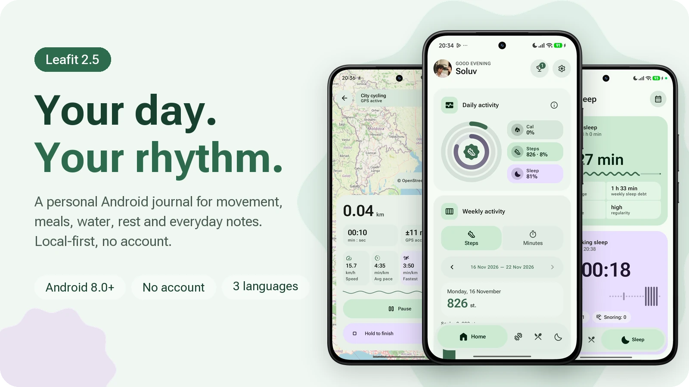
  </picture>
</p>

<div align="center">

# Leafit

**A personal Android journal for movement, meals, water, rest and everyday notes.**

Workouts with live GPS routes, a sleep tracker with alarms, meal plans, challenges and shareable cards —<br />
all in one calm interface inspired by **Material 3 Expressive**. Local-first. No account.

<p align="center">
  <a href="https://github.com/So1uv/Leafit/releases/latest"></a>&nbsp;
  &nbsp;
  <a href="https://github.com/So1uv/Leafit/releases"></a>
</p>

<p align="center">
  &nbsp;&nbsp;
  &nbsp;&nbsp;
  &nbsp;&nbsp;
  &nbsp;&nbsp;
  <a href="https://ko-fi.com/soluv"></a>&nbsp;&nbsp;
  
</p>

[What's new](#whats-new) &nbsp;·&nbsp; [Screens](#screens) &nbsp;·&nbsp; [Features](#features) &nbsp;·&nbsp; [Data & privacy](#data) &nbsp;·&nbsp; [For developers](#developers) &nbsp;·&nbsp; [Download](#download)

</div>

<br />

<a name="whats-new"></a>

## What's new in 2.5

Leafit 2.5 is the biggest update so far. The four journals stay at the center, and everything around them has grown.

- **Sleep tracker & alarms** — a background tracker that records short sound clips, flags what sounds like snoring or talking and builds a night report. A separate alarm list with repeat days, a smart wake-up window and a full-screen alarm that works without the tracker.
- **Leafit Wrapped** — turn a workout or a finished challenge into a card for stories and chats: card, 9:16, 4:5, 1:1 or a transparent sticker PNG.
- **Challenges** — 32 ideas in five categories plus your own goals for 7, 14 or 30 days, counted from your existing records.
- **Kitchen & plan** — recipes with macros per 100 g, a dated meal plan and a shopping list.
- **Workouts** — interval mode, equipment profiles, personal bests per exercise and a redesigned result screen.
- **New first run** — a three-step setup with BMI, a calorie goal and optional body measurements.
- **Widgets & notifications** — six widgets that scale from 1×1 to 4×3, and one consistent layout for every live notification.
- **Design** — connected button groups, wavy progress, filled Material Symbols, spring motion and a refined palette across the whole app.

<br />

<a name="screens"></a>

## Eight spaces. One personal journal.

Each panel below combines real screenshots of Leafit 2.5 with an overview of the screen. Select a panel to open the full-size screenshot.

<a name="home"></a>

<a href="docs/screenshots/home.webp">
  <picture>
    <source media="(max-width: 600px)" srcset="docs/readme/01-home-mobile.webp" />
    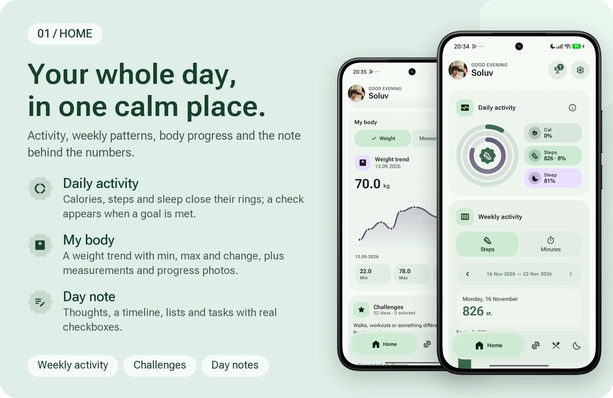
  </picture>
</a>

### Home — the day, brought together

A personal greeting, activity rings for calories, steps and sleep, and a weekly chart you can page through or jump to with a calendar. **My body** keeps your weight trend with minimum, maximum and change for the period, next to measurements and progress photos.

The **day note** leaves room for context: free thoughts, a timeline of the day, lists and tasks with real checkboxes. Search earlier notes and pin the ones you want to keep close.

**At a glance:** activity rings · weekly activity · My body · challenges · day notes · achievements

<br />

<a name="workouts"></a>

<a href="docs/screenshots/gps-live.webp">
  <picture>
    <source media="(max-width: 600px)" srcset="docs/readme/02-workouts-mobile.webp" />
    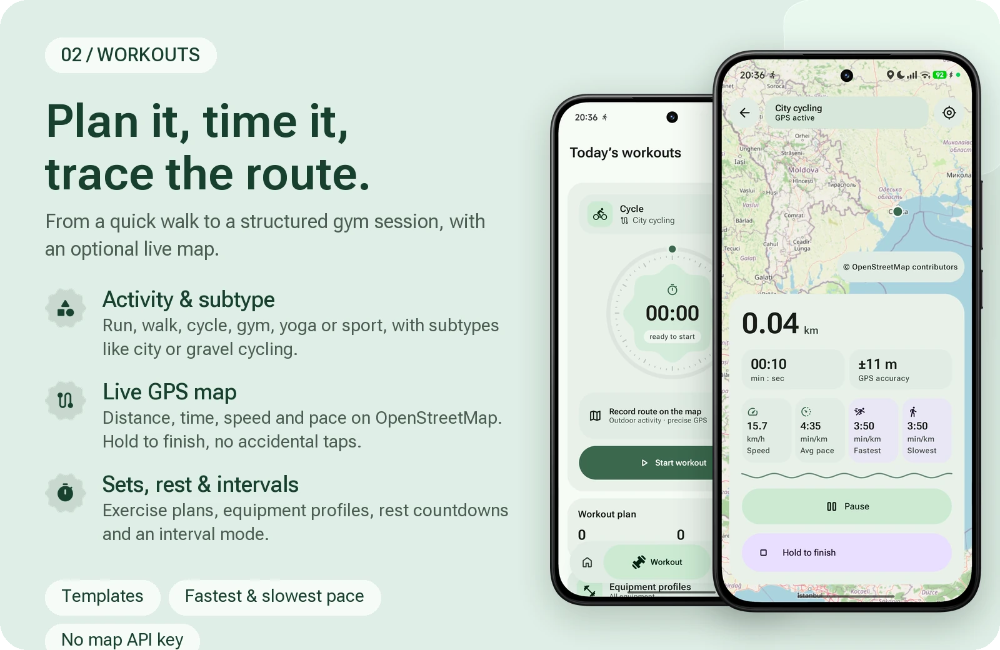
  </picture>
</a>

### Workouts — a session with room for detail

Pick an activity and a subtype — running, walking, cycling, gym, yoga, Pilates, swimming or sport — then decide how much detail to record. Add exercises and sets with repetitions, weight, time, distance or score, use rest countdowns or switch on **interval mode** to alternate work and rest automatically. Save a setup as a template and keep **equipment profiles** for the gear you use.

For outdoor sessions, turn on **Record route on the map**. A full-screen OpenStreetMap view shows your position and route, with distance, time, GPS accuracy, speed, average pace and fastest/slowest pace. Pace is smoothed over a short window, so a single GPS jump does not spoil the numbers. **Hold to finish** prevents an accidental tap from ending the session.

**Session tools:** subtypes · sets & reps · rest timers · intervals · templates · equipment · live map · personal bests

<br />

<a name="wrapped"></a>

<a href="docs/screenshots/wrapped.webp">
  <picture>
    <source media="(max-width: 600px)" srcset="docs/readme/03-wrapped-mobile.webp" />
    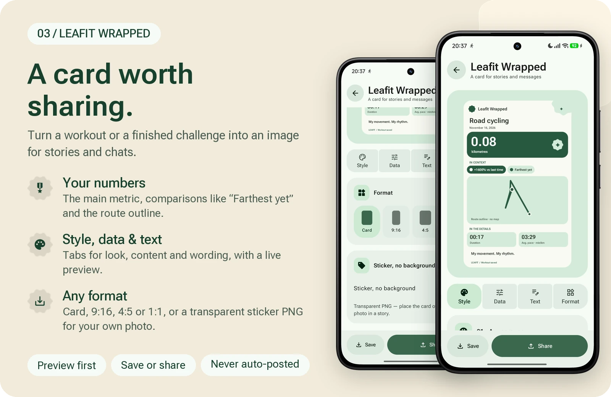
  </picture>
</a>

### Leafit Wrapped — a card worth sharing

Open a saved workout or a completed challenge and create a card around its main number. Leafit adds context such as **“+1600% vs last time”** or **“Farthest yet”**, the route outline and the date. Tabs for style, data, text and format keep the editor tidy, and the live preview shows exactly what will be exported.

Choose a **card, 9:16, 4:5 or 1:1** layout, or export a **transparent sticker PNG** to place over your own photo. Save the image or send it through Android's share sheet. Nothing is posted automatically.

**Sharing tools:** live preview · comparisons · route outline · four formats · sticker PNG

<br />

<a name="meals"></a>

<a href="docs/screenshots/water.webp">
  <picture>
    <source media="(max-width: 600px)" srcset="docs/readme/04-meals-mobile.webp" />
    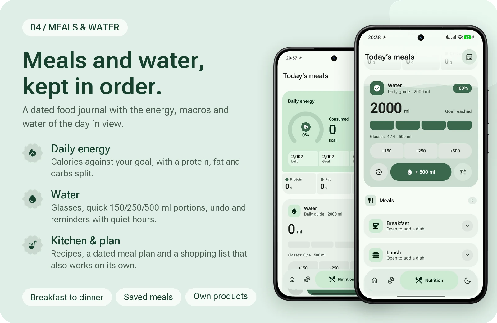
  </picture>
</a>

### Meals & water — everyday entries, kept in order

The energy card compares what you ate with your daily goal and shows the protein, fat and carbs split. Breakfast, lunch, snack and dinner each have their own group; add a dish from your products or enter it manually, and reuse saved meals.

The water card counts glasses, adds 150, 250 or 500 ml with one tap, undoes the last portion and marks the moment the daily guide is reached. Reminders respect quiet hours. **Kitchen & plan** brings recipes, a dated meal plan and a shopping list together — the list also works on its own.

**Everyday tools:** daily energy · macros · meal groups · own products · water journal · recipes · meal plan · shopping list

<br />

<a name="sleep"></a>

<a href="docs/screenshots/sleep-tracker.webp">
  <picture>
    <source media="(max-width: 600px)" srcset="docs/readme/05-sleep-mobile.webp" />
    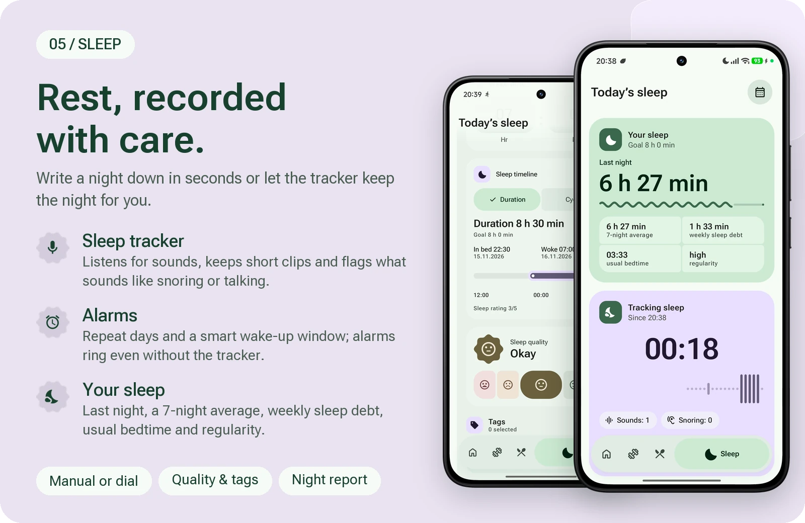
  </picture>
</a>

### Sleep — time, rest and how the night felt

**Your sleep** shows last night, a 7-night average, weekly sleep debt, your usual bedtime and how regular your schedule is. Enter a night manually or with the moon-and-sun dial, rate its quality and add tags and a note.

The **sleep tracker** runs in the background while the phone lies near your pillow. It adapts to the room's background noise, saves short clips of louder moments (including two seconds before each one) and marks what sounds like snoring or talking. The night report brings a volume chart, events and a clip player together. **Alarms** live in their own list with repeat days, a smart wake-up window, gradual volume and an optional math task to dismiss — and they ring even when the tracker is off.

> [!NOTE]
> Sleep stages are not measured. The cycle chart is an illustration based on the recorded duration, and sound labels are estimates, not a medical assessment.

**Rest journal:** sleep tracker · night report · alarms · manual or dial input · quality & tags · weekly summary

<br />

<a name="goals"></a>

<a href="docs/screenshots/achievements.webp">
  <picture>
    <source media="(max-width: 600px)" srcset="docs/readme/06-goals-mobile.webp" />
    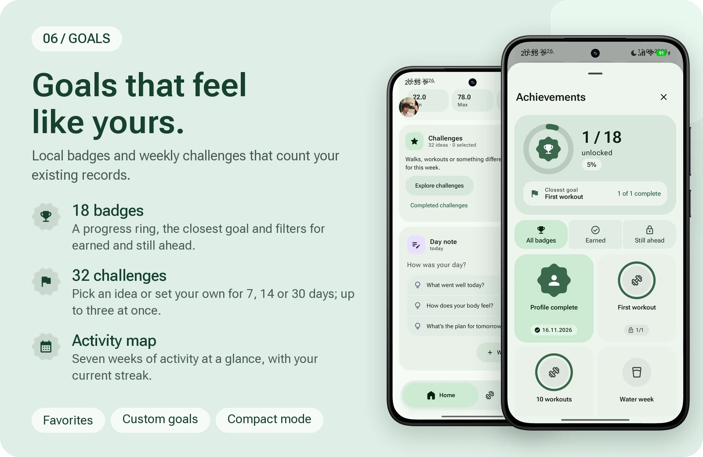
  </picture>
</a>

### Goals — badges and challenges that count what you already do

**18 achievements** unlock locally from your journal. A progress ring shows how far you are, the closest goal is always on top, and filters separate earned badges from the ones still ahead.

**Challenges** offer 32 ideas in five categories — or your own goal with a name, metric, daily threshold and color. Run up to three at once for 7, 14 or 30 days; steps, workouts, sleep, water, meals and notes are counted automatically. The block can be compact or hidden entirely.

<br />

<a name="profile"></a>

<a href="docs/screenshots/profile.webp">
  <picture>
    <source media="(max-width: 600px)" srcset="docs/readme/07-profile-mobile.webp" />
    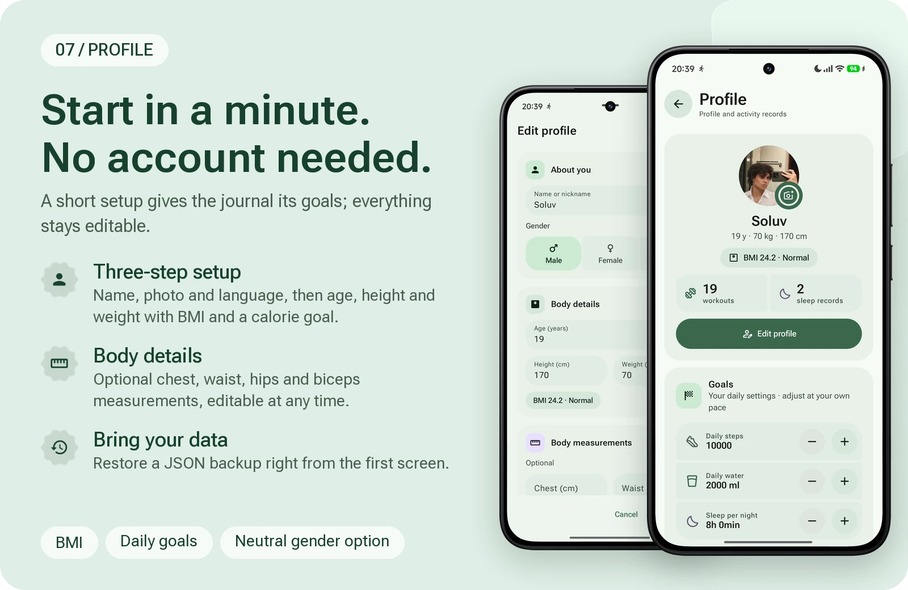
  </picture>
</a>

### Profile & first run — start in a minute

A three-step setup asks for a name, photo and language, then age, height and weight with large − / + controls. BMI and a daily calorie goal appear right away; body measurements are optional. You can also restore a backup from the very first screen.

The profile keeps your goals for steps, water and sleep, the activity map with your current streak and an edit sheet with a neutral gender option.

<br />

<a name="settings"></a>

<a href="docs/screenshots/settings.webp">
  <picture>
    <source media="(max-width: 600px)" srcset="docs/readme/08-settings-mobile.webp" />
    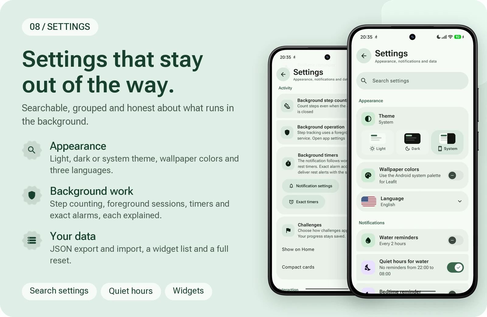
  </picture>
</a>

### Settings — searchable and clear about the background

Search any setting. Choose a light, dark or system theme, wallpaper colors on Android 12+ and **English, Ukrainian or Russian**. The activity group explains background step counting, foreground sessions, background timers and exact alarms. The widget list adds any widget in one tap, and the data group holds export, import and a full reset.

<br />

<a name="features"></a>

## More ways to make the journal yours

<picture>
  <source media="(max-width: 600px)" srcset="docs/readme/09a-notify-widgets-mobile.webp" />
  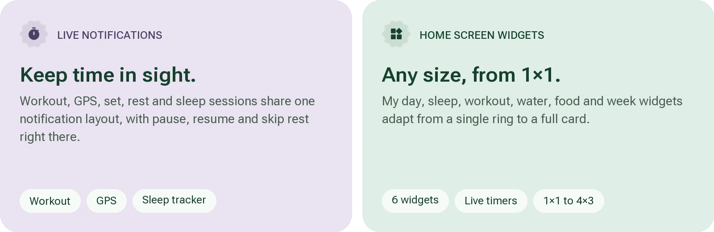
</picture>

### Follow the session outside the app

Every live notification shares one layout: an icon, a title, a large value or running timer, a progress bar and up to three metric tiles. Pause, resume or skip rest from a workout notification; follow distance, pace and GPS state on a route; see the sleep timer, sound count and next alarm at night. On Android 16 live sessions can appear as a status-bar chip.

**Six home screen widgets** — My day, Sleep, Workout, Water, Food and This week — adapt from a single 1×1 ring to a full 4×3 card. Add them from **Settings → Widgets** or your launcher's widget picker. Long-press the app icon for shortcuts to water, workouts and sleep.

<br />

<picture>
  <source media="(max-width: 600px)" srcset="docs/readme/09b-haptics-notes-mobile.webp" />
  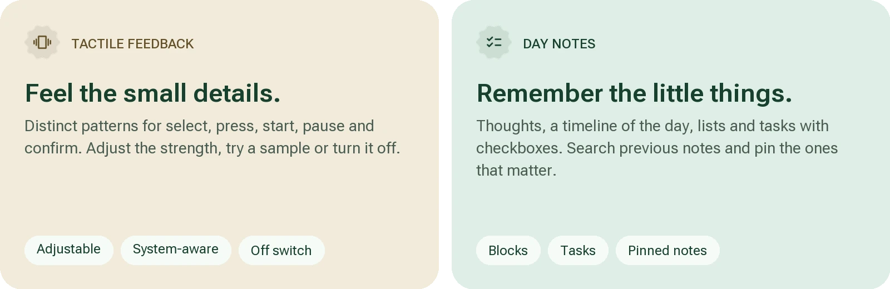
</picture>

### Feedback you can feel, notes you can find

Leafit's haptic engine uses distinct short patterns for **selection, pressing, starting, pausing and confirmation**. Adjust the strength, try a sample or switch it off; system touch-vibration settings are respected.

Day notes are built from blocks — thoughts, a timeline, lists and tasks — and stay connected to the date they belong to.

<br />

<a name="gallery"></a>

### A closer look

<a href="docs/screenshots">
  <picture>
    <source media="(max-width: 600px)" srcset="docs/readme/10-gallery-mobile.webp" />
    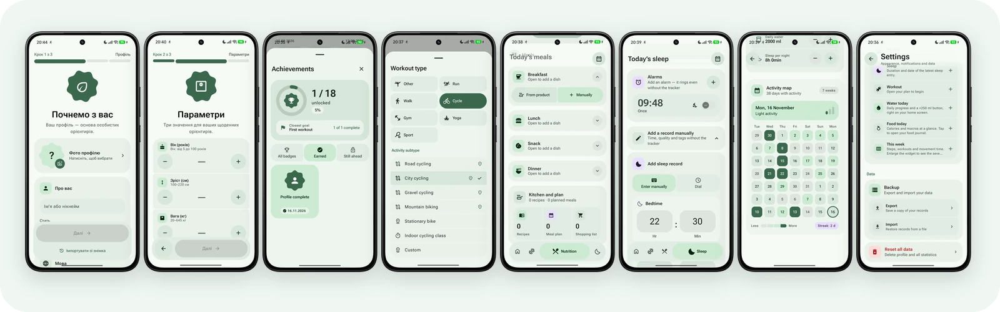
  </picture>
</a>

<br />

<a name="data"></a>

## Your journal, on your device

<picture>
  <source media="(max-width: 600px)" srcset="docs/readme/09c-data-design-mobile.webp" />
  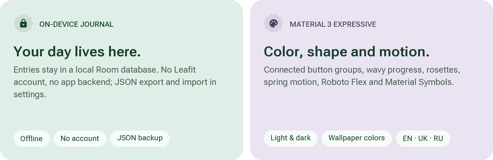
</picture>

### Local records, available offline

Leafit stores your journal in a **local Room database**. Workouts, meals, water, sleep, notes and tracked nights stay on the device. There is no Leafit account and no application backend, so there is nothing to sign up for. Network access is used for map tiles; Android system backup may apply according to your device settings.

**JSON export and import** are available in settings. Sharing a card is always a separate, deliberate action.

<details>
<summary><strong>Which permissions support these features?</strong></summary>

- **Precise location** — optional GPS route recording.
- **Physical activity** — step counting on devices with a step sensor.
- **Microphone** — the optional sleep tracker; audio is analyzed on the device and only the clips you allow are kept.
- **Notifications** — live sessions, timers and reminders.
- **Exact alarms & full-screen intent** — rest alerts and alarms on time, even on a locked screen.
- **Vibration** — haptic feedback and alerts.
- **Run at startup** — restoring alarms and step counting after a reboot.
- **Foreground services** — user-started workouts, routes, the sleep tracker and step counting.
- **Internet** — map tiles.

Step counting depends on device hardware and permissions. GPS uses Google Play services. Manufacturer power-saving policies can affect background work; Leafit explains the relevant settings where it matters.

</details>

<br />

<a name="developers"></a>

## Built with Android in mind

**Kotlin 2.3 · Jetpack Compose · Material 3 · Room · DataStore · Coroutines & Flow · MapLibre · Coil**

The UI is written in Compose with a shared set of expressive components. ViewModels expose `StateFlow` built from Room repositories. Foreground services handle workouts, GPS routes, the sleep tracker and step counting; widgets use Android's widget APIs with native chronometers, and cards are rendered with Android Canvas and shared through `FileProvider`.

### Build your own copy

Use **JDK 17**, **Android SDK 36** and a recent Android Studio. Leafit runs on **Android 8.0 / API 26** and later.

```bash
git clone https://github.com/So1uv/Leafit.git
cd Leafit
```

Open the project in Android Studio, sync Gradle and run the `app` configuration. No map API key or cloud project is needed.

<details>
<summary><strong>Command-line builds & source layout</strong></summary>

**macOS / Linux**

```bash
chmod +x gradlew
./gradlew assembleDebug
```

**Windows**

```powershell
.\gradlew.bat assembleDebug
```

The debug APK is written to `app/build/outputs/apk/debug/app-debug.apk`. Unit tests run with `./gradlew test`.

Within `app/src/main/java/com/example/fitnesstracker/`:

- `ui/components/` — shared controls, dials, charts and icons.
- `ui/screens/` — home, workouts, nutrition, sleep, onboarding and settings.
- `ui/theme/` — color, typography and theme preferences.
- `viewmodel/` — screen state and presentation logic.
- `data/` — Room entities, DAOs and repositories.
- `workout/` — activity catalog, exercise journal, intervals and session timers.
- `tracking/` — GPS recording, telemetry and maps.
- `sleep/` — sleep tracker service, night storage and alarms.
- `sharing/` — Leafit Wrapped and workout cards.
- `widgets/` — home screen widgets.
- `utils/` — haptics, steps, reminders, language and backup helpers.

</details>

### Help shape what comes next

Bug reports, translations, focused pull requests and feature ideas are welcome. For a bug, include the device model, Android version, Leafit version and steps to reproduce; a screenshot or short recording helps with visual issues. For a code change, describe what changed and how you checked it, with light and dark screenshots for UI changes.

## Tested in the real world

Beyond emulators, Leafit is tested on physical devices across different Android ecosystems:

- **Samsung Galaxy S10** · `One UI` · `Android 12`
- **Xiaomi 15** · `HyperOS` · `Android 15/16`
- **Google Pixel 7** · `Pixel` · `Android 16/17`

> [!NOTE]
> Behavior may still vary with Android version, firmware and manufacturer settings — especially background work, notifications and alarms.

<br />

<a name="download"></a>

<a href="https://github.com/So1uv/Leafit/releases/latest">
  <picture>
    <source media="(max-width: 600px)" srcset="docs/readme/11-get-leafit-mobile.webp" />
    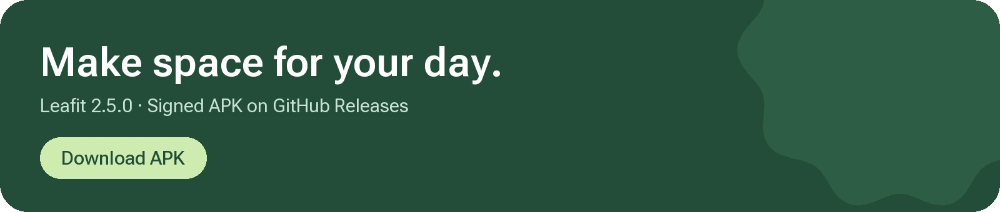
  </picture>
</a>

<p align="center"><a href="https://github.com/So1uv/Leafit/releases">Release notes</a> &nbsp;·&nbsp; <a href="https://github.com/So1uv/Leafit/issues">Feedback & ideas</a> &nbsp;·&nbsp; <a href="#top">Back to top ↑</a></p>
